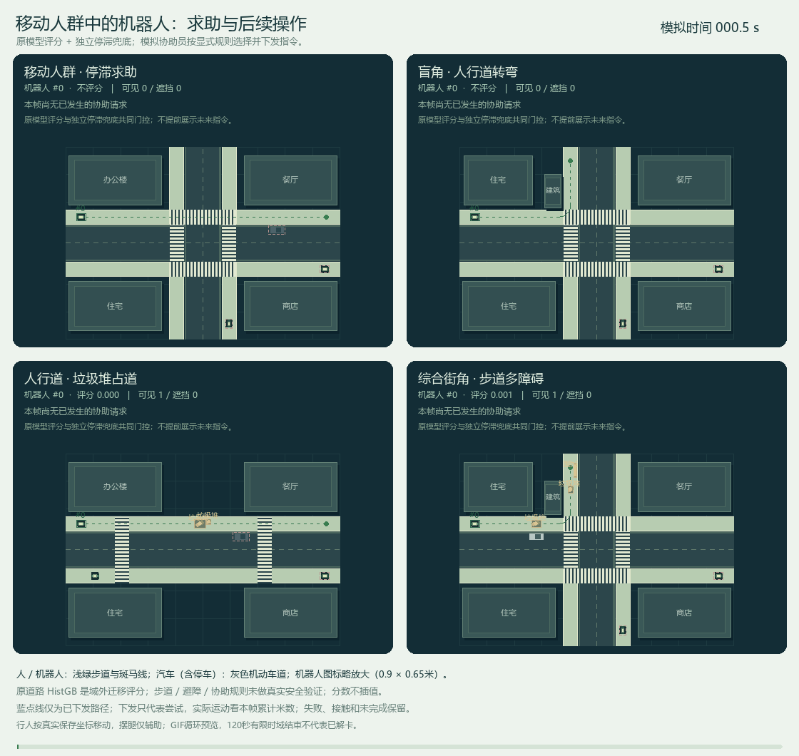
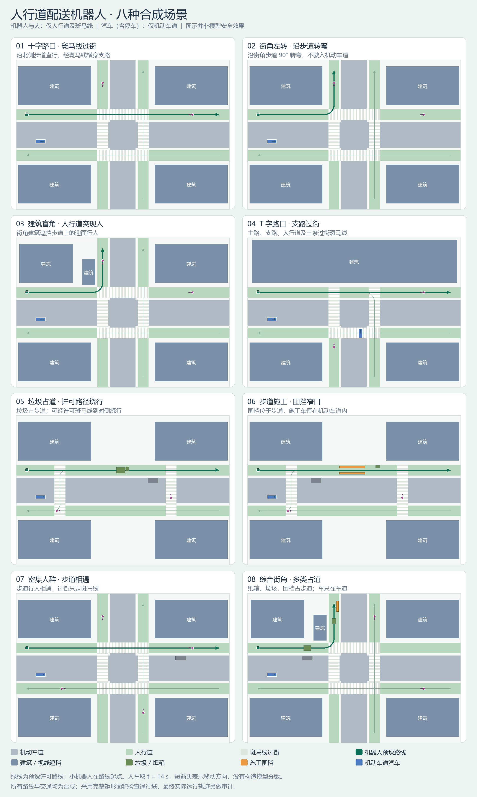
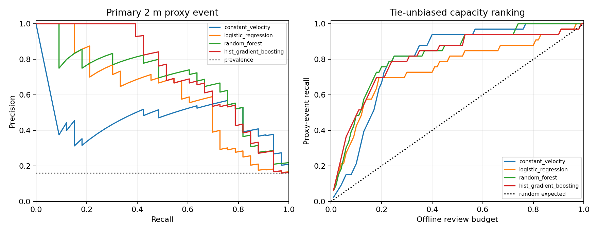

# 自动配送应用背景下的近距离交互预测

[在线体验 Demo](https://thisisyk.github.io/sidewalk-delivery-robot-research/) · [模型下载及许可](https://github.com/thisisyk/sidewalk-delivery-robot-research/releases/tag/model-v1)

在线版是非商业研究的预计算合成回放，可切换八个场景、播放、暂停、拖动时间和查看协助记录。模型分数来自已保存的真实模型推理。网页不运行新的模型推理；修改密度、阈值或模拟协助方案并重算，需按下文启动本地服务。

<!-- request-fallback:start -->
## 独立行为求助补充

已加入不依赖模型评分的停滞、互堵和多次规划失败求助，并将协助处理改为显式指令模块。原模型高分通道保留；分数无效不再自动阻断行为请求。固定八场景、开/关遮挡共16个配对设置中，完成任务由70/96变为74/96，请求总数由0变为38，矩形接触机器人帧由76变为80。这些是固定合成条件下两项改动的组合机制比较，不能全部归因于求助触发；新增通道不是机器学习训练结果；未完成、接触和规划失败全部保留。

完整触发假设、逐场景对照、原因计数和残留限制见[人行道报告](docs/sidewalk_demo_zh.md)与[配对比较](results/sidewalk/fallback_comparison.json)。原真实研究数据与模型选择不变；用户已于2026-10-23授权公开本项目，发布记录见[publication.json](publication.json)。
<!-- request-fallback:end -->

使用 **Waymo Open Motion Dataset** 研究过去一秒的运动状态能否预测未来三秒新发生的近距离交互，以及有限离线复核预算应如何分配。

**当前状态：真实道路数据研究及追加分析已完成；主Demo为带独立求助与显式协助模块的人行道配送机器人，含模型发布、下载校验与网站发布包检查的98项软件测试通过。用户已于2026-10-23明确授权公开项目并追加发布权重。** 仓库地址：[thisisyk/sidewalk-delivery-robot-research](https://github.com/thisisyk/sidewalk-delivery-robot-research)；授权、公开范围与实际发布状态以[publication.json](publication.json)为准。原运行产物中的待审字段保留其生成时的历史状态。

**模型权重补充发布：** 用户随后明确要求分享模型权重。本次按已冻结的857例训练集、194列特征和HistGB seed42配置重新拟合并导出可加载模型，不重新选模、不改写原评估结果。模型、来源与一致性核验见[模型说明](models/README.md)及[模型清单](models/frozen_histgb_seed42.manifest.json)。原始22个Waymo分片不放入公共仓库；提供[官方对象及校验清单](configs/womd_download_manifest.json)和各自授权下载工具。

**模型仅限非商业研究使用。模型整体及下游使用、修改受 [Waymo 非商业数据协议](https://waymo.com/open/terms/)约束；不得用于车辆操作或辅助操作、生产系统或商业用途。** 模型随附[完整协议](licenses/WAYMO_DATASET_LICENSE_NON_COMMERCIAL_MARCH_2025.txt)与[署名声明](models/NOTICE.txt)，不能按普通无限制开源权重使用。

Waymo 与 Uber Eats 有自动配送合作，但本项目公开数据**没有 Uber Eats 订单归属、真实人工接管或每单成本标签**。原始图片中的小型人行道机器人与道路汽车存在差异，本实验只研究共同的交互预测问题。项目不提供车辆控制功能。

## 当前主Demo：人行道配送机器人

打开 [`demo/index.html`](demo/index.html)，默认从“密集人群·步道相遇”的首帧开始播放，不跳到协助或到达时刻。可在十字路口、步道转角、建筑盲角、T字路口、垃圾占道、施工窄口、密集人群和综合街角之间切换。**机器人和行人只走人行道与斑马线，汽车包括停放车只在机动车道。** 浅绿步道、灰色机动车道与斑马线分层绘制，机器人绘制为小箱体六轮设备。[当前人行道版说明与结果](docs/sidewalk_demo_zh.md) · [操作指南](docs/demo_guide_zh.md)

行人随保存轨迹的连续坐标移动；画面默认播放，可暂停、重播和拖动。系统设置“减少动态”时需点击“开始动画”。摆腿只辅助识别人正在行走，实际位置由同ID轨迹帧平滑插值；模型分数保持原帧值，不插补或伪装重算。离线只读取 `sidewalk_gallery.js`，缺失时明确报错，不回退到旧道路场景。本地模型服务支持改变密度、机器人数量、遮挡与协助参数。

**使用的是原道路数据训练的HistGB，机器人属于未经验证的域外迁移。** 模型只对当前可见的运动交互计算近距分数；步道约束、过街路线、避障、排队和协助均由独立规则执行。当前已处于两米内时仍不评分，但持续停滞、机器人互堵和多次规划失败可经独立行为通道求助。建筑遮挡影响逐机器人观测历史，未见目标不送入模型，也不回填隐藏历史。垃圾、建筑与围挡没有被伪装成车辆训练类别。

回放保留垃圾或人群导致的停滞、未完成以及移动行人与已停机器人的接触。完成数、请求、等待、矩形接触机器人帧和各类越界帧均应同时查看；请求恢复不等于一定解困，接触帧不是独立事故次数，零越界或零接触也不构成真实安全验证。最新场景汇总以 `results/sidewalk/` 和[人行道报告](docs/sidewalk_demo_zh.md)为准；旧人行道聚合快照保留在 `results/sidewalk_baseline/`。





## 追加分析与历史演示

以下追加实证结果仍基于同一206例冻结评估集：低容量排序优势较强，但不等于高容量、概率校准或协助决策都更好。复核10例时，HistGB发现10/33事件，恒速4/33；复核41例时分别23/33与22/33，差值区间跨零。低分<0.05的160例仍有8个事件，不能把分数直接读作准确概率。[追加实证分析](docs/extension_report_zh.md)

24种负荷条件、100个种子和5种策略的模拟显示，精确筛选在复核资源紧张时可能缓解积压，人力充足时全部复核覆盖更多。**30/60秒服务晚于三秒标签窗口，此处只研究事后复核资源规划。** [完整排队实验](docs/queue_simulation_zh.md)

旧三通道演示和道路城市版保留为历史研究记录，**不是当前主Demo**。三通道静态阻挡中，原开发阈值0.956未请求协助，8/12辆到达；探索阈值0.500请求3次、11/12辆到达；固定等待请求规则请求4次、12/12辆到达。这些历史数值不能当作人行道机器人的结果。[历史道路扩展记录](docs/urban_scenarios_zh.md) · [历史三通道结果](docs/demo_guide_zh.md#历史三通道实验不再是主demo)

原模型在857个训练样本上重训后，206个原评估分数的最大差为1.11×10⁻¹⁶。各运行清单中的代码哈希是其生成时的快照；新增合成场景不改写原真实研究结果。

## 已完成的研究结论

在本次保留的道路交通样本上，交互特征改善了低复核预算下的近距离事件排序。开发集选出的 HistGradientBoosting 在锁定评估集上的结果为：

| 方法 | AP | 复核20例覆盖事件数 | 事件召回率 | 复核精确率 |
| --- | ---: | ---: | ---: | ---: |
| 恒速外推 | 0.449 | 7 / 33 | 21.21% | 35.00% |
| HistGradientBoosting | 0.730 | 16 / 33 | 48.48% | 80.00% |

AP差值为0.281，配对分片自举95%区间为[0.175, 0.378]；召回差值为27.27个百分点，区间为[13.89, 35.71]。**简单地图特征没有额外主任务收益，高预算时恒速基线在部分区间更好。**

原始8,910例中，71.64%因未来轨迹不完整而删失；主评估集只有206例、33个正例和5个分片。因此结论限于当前筛选子集的离线代理任务，不能推算实际接管、安全或配送成本收益。详见[完整中文报告](docs/final_report_zh.md)、[验证记录](docs/validation.md)与[案例核查](docs/case_review.md)。



## 研究问题

1. 非线性学习模型是否优于恒速几何外推的强基线？
2. 周围交通参与者及静态地图特征是否带来增益？
3. 在固定 5%、10%、20% 离线复核容量下，各方法覆盖多少代理事件？

没有提升或证据不足同样是应如实报告的结论。

## 数据与标签

- 输入为官方 `uncompressed/scenario` TFRecord。不是 `tf_example`、感知图像集或官方隐藏真值测试集。
- 使用 `current_time_index` 锚点前十帧及当前帧，共约一秒；未来三十帧仅用于标签。
- 候选是当前有效、五十米内的车辆、行人和骑行者，按当前距离选最多十六个。未来才出现的对象不进入候选；没有候选的场景排除并计数。
- 代理事件：参考车与任意候选目标的二维旋转矩形间距在未来三秒内不超过两米。另报告一米、三米敏感性。
- 当前已经满足相应阈值的场景排除；任何所选目标或参考车的未来真值缺失，整场景删失并计数。
- 近距离不自动意味着危险、故障或需要接管。二维标签可能受高度差、离散采样、跟踪误差影响。

详见 [实验协议](docs/protocol.md)、[局限](docs/limitations.md)、[数据获取](docs/data_access.md)。

## 实验

| 方法 | 输入与定位 |
| --- | --- |
| 恒速外推 | 仅当前位置、航向、速度；用预测最小车体间距排序 |
| Logistic Regression | 线性基线 |
| Random Forest | 非线性树模型 |
| HistGradientBoosting | 梯度提升树 |

学习模型比较 `ego`（本车）、`interaction`（加入目标交互）、`full`（再加地图）三类特征，固定种子 42、7、2026。主模型只按两米主任务、全特征、种子42的开发集 AP 选择，随后锁定。

训练与验证保留官方边界。固定训练分片00000—00011；验证分片00000—00009中，偶数分片作开发集，奇数分片作锁定评估集。分片不是已核实的原始日志分组，未知重叠窗口仍是限制。

指标包括 AP（非梯形PR-AUC）、ROC-AUC、预算召回和精确率、随机复核lift、Brier，以及开发集固定阈值在评估集的实际复核率。边界同分采用与标签无关的随机选择期望。主模型相对恒速基线报告配对自举区间。

## 运行

需要 Python 3.11 或更高版本。标准环境可执行：

```text
python -m venv .venv
# 激活环境后：
python -m pip install -r requirements.txt
python -m pip install -e . --no-deps
```

只运行交互Demo时，无需下载原始Waymo数据或重新训练。核对[模型清单](models/frozen_histgb_seed42.manifest.json)并确认文件来自可信发布后运行：

```text
python scripts/serve_demo.py --model-artifact models/frozen_histgb_seed42.joblib --model-manifest models/frozen_histgb_seed42.manifest.json --trust-model-artifact --port 8766
```

随后访问 `http://127.0.0.1:8766/`。`joblib`反序列化可能执行代码；显式信任参数只用于确认可信来源，哈希校验不能让恶意文件变得安全。该服务仅用于本机合成研究演示，不能连接真实车辆。

从官方渠道注册并下载数据，保留原始文件名：

```text
data/womd/training/training.tfrecord-00000-of-01000
...
data/womd/validation/validation.tfrecord-00000-of-00150
...
```

已自行完成Waymo注册、同意协议并通过Google官方工具取得访问权的用户，可按本次22分片清单下载和校验：

```text
python scripts/download_womd.py --destination data/womd --download --registered-with-waymo
python scripts/download_womd.py --destination data/womd --verify-only
```

下载脚本不代替用户接受协议、登录或取得访问权；不会从本仓库提供原始数据镜像。完整步骤见[数据获取](docs/data_access.md)。

解析需要官方 protobuf 类。可安装 `grpcio-tools`，再下载固定提交的八份官方 schema 并编译：

```text
python -m pip install grpcio-tools
python scripts/fetch_waymo_schema.py --download-schema
```

若系统不允许加载编译器扩展，可先通过 PyPI 下载官方 `waymo-open-dataset-tf-2-12-0==1.6.7` wheel，再使用只提取八个 protobuf Python 文件的路径（不安装 TensorFlow 或 wheel 内的本地二进制）：

```text
python -m pip download waymo-open-dataset-tf-2-12-0==1.6.7 --no-deps --only-binary=:all: --platform manylinux_2_24_x86_64 --python-version 310 -d artifacts/wheels
python scripts/fetch_waymo_schema.py --wheel <官方wheel路径>
```

脚本验证固定发布文件 SHA256。两种 schema 来源及其清单会分别记录，均不包含任何行驶记录。

```text
python scripts/prepare.py --data-root data/womd --output artifacts/prepared --workers 2
python scripts/train_evaluate.py --input artifacts/prepared/samples.csv --output results/reproduction
python -m unittest discover -s tests -v
```

预处理支持逐分片缓存恢复，验证 CRC32C 和文件 SHA256；数据、协议、提取代码或缓存改变时拒绝复用。实验不覆盖已有运行清单。测试中的人工构造样例只证明代码行为，不作为实证数据。

本机因原生库加载限制，实际使用两个 Python 3.12 环境：预处理版本固定在 `requirements-preprocess.txt`，建模版本固定在 `requirements.txt`。如需尽量逐字节复现缓存，应使用前者单独建立预处理环境，再使用后者建立建模环境；每次实际运行的版本也记录在来源与运行清单中。没有更改系统应用控制策略。

## 研究产物

- `demo/index.html`、`sidewalk_gallery.js`：当前人行道机器人界面与合成回放；含移动行人。
- `docs/sidewalk_demo_zh.md`、`results/sidewalk/`：当前合成机制说明、汇总与审计；[协助生命周期审计](results/sidewalk/assistance_audit.json)核对请求、指令与真实执行。
- `demo/sidewalk_scenarios.gif`、`sidewalk_atlas.png`：当前人行道动画与分区总览。
- `docs/final_report_zh.md`：已完成核查的最终研究报告；用户已授权本项目公开发布，见[发布记录](publication.json)。
- `results/real/report.md`：保留原样的自动运行草稿；其中审阅状态是生成时的快照。
- `results/real/metrics.csv`、`dev_fixed_policies.csv`：聚合对比。
- `results/real/summary.json`：主分析与不确定性，保留生成时的待审状态。
- `results/real/primary_curves.png`：PR及预算召回曲线。
- `results/real/run_manifest.json`、`primary_selection.json`：版本、参数、哈希和开发集选模记录。
- `results/real/numeric_audit.json`、`label_audit.json`：独立数值与标量几何核查。
- `results/real/review_status.json`：后续助手核查与用户发布审批状态。
- `results/private/`：逐场景预测，仅本地保留。
- `models/frozen_histgb_seed42.joblib`：本次补充发布的冻结配置重拟合模型；模型清单保存参数、来源、文件校验值和一致性核验。
- `configs/womd_download_manifest.json`、`scripts/download_womd.py`：22个官方对象的路径与校验清单、授权下载及本地完整性检查工具；不含原始分片。

本次已完成独立公式复算及三个确定性案例的助手核查，未进行人类专家标签有效性研究。复现运行使用新目录，避免覆盖保留的原始结果。查看核查命令与原始自动报告状态的解释，见[验证记录](docs/validation.md)。

## 发布范围

用户已于2026-10-23授权公开代码、协议、聚合指标、研究报告与明确标注的合成回放，并随后明确要求补充模型权重。模型按Waymo协议第2(c)节附完整协议、突出用途限制及署名发布。第2(b)节要求原始数据仅向已注册并同意协议的接收者分发，公开GitHub仓库无法限定所有接收者，因此22个原始分片继续本地保留，改为提供官方对象及校验清单与授权下载工具。[官方协议](https://waymo.com/open/terms/)

特征缓存、逐场景真实标签与预测、账号信息和凭据不进入发布包。原运行清单中的 `no_weights_saved` 描述当时没有保存权重的事实；本次新增导出和清单单独留痕，不重写历史文件。任何仓库说明都不替代适用协议；授权与发布状态见[publication.json](publication.json)。

## 来源

- [Waymo Open Dataset](https://waymo.com/open/)
- [官方代码与 schema](https://github.com/waymo-research/waymo-open-dataset)
- [官方 FAQ](https://waymo.com/open/faq/)
- [Uber 与 Waymo 配送公告](https://www.uber.com/us/en/newsroom/uber-and-waymo-autonomous-deliveries-phoenix/)
- Ettinger et al., *Large Scale Interactive Motion Forecasting for Autonomous Driving*, ICCV 2021.

使用真实数据后，工作须按协议署名：This software was made using the Waymo Open Dataset, provided by Waymo LLC under the Waymo Dataset License Agreement for Non-Commercial Use, available at https://waymo.com/open/terms/, and your access and use of such work are governed by the terms and conditions therein.
