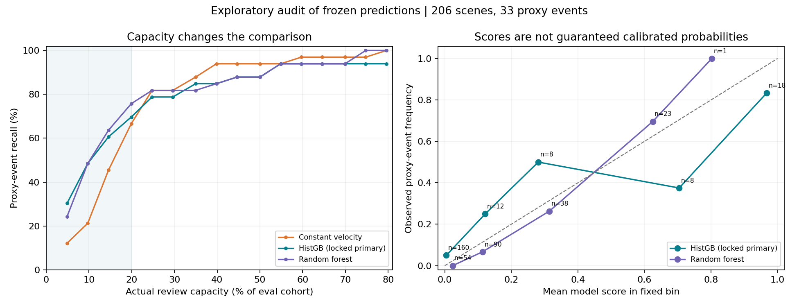

# 冻结模型追加实验：复核容量、阈值迁移与失败分层

本追加分析使用原实验已冻结的真实评估分数，未重新选择模型、调参或改变标签。主模型仍为全特征 HistGradientBoosting（seed=42）。这些是看到主结果后的探索性诊断，不能当作新的独立验证集。

## 1. 收益取决于复核容量

在同一个206例、33个未来三秒内新进入2米轮廓间距事件的评估队列中，按分数排序分配有限复核容量。容量为向下取整后的整数，边界同分采用与标签无关的随机化期望。

| 名义容量 | 实际名额 | 恒速发现 / 33 | HistGB发现 / 33 | 随机森林发现 / 33 | HistGB－恒速召回差95%区间 |
| --- | ---: | ---: | ---: | ---: | --- |
| 5% | 10 | 4.00 | 10.00 | 8.00 | [6.7, 26.7] 个百分点 |
| 10% | 20 | 7.00 | 16.00 | 16.00 | [13.9, 35.7] 个百分点 |
| 20% | 41 | 22.00 | 23.00 | 25.00 | [-5.6, 25.0] 个百分点 |

区间为1000次配对来源分片自举，只有5个评估分片，且未验证驾驶日志独立性；为逐点探索性区间，未做多重比较校正。区间不能代替更大规模外部验证。

完整5%至80%容量曲线见下图。随着容量扩大，恒速方法也会覆盖更多事件；排序优势不能外推为所有运营负荷下的优势。

## 2. 开发集阈值并不能固定线上负荷

以下阈值均在原开发集确定；在评估集只应用、不重新设阈值。它与在评估队列强制选择前10%是两种策略。

| 方法 | 开发集名义请求比例 | 评估请求数 | 评估请求比例 | 发现事件 | 事件召回 | 精确率 |
| --- | --- | ---: | ---: | ---: | ---: | ---: |
| constant_velocity | 5% | 6.67 | 3.2% | 2.50 | 7.6% | 37.5% |
| constant_velocity | 10% | 27.00 | 13.1% | 14.00 | 42.4% | 51.9% |
| constant_velocity | 20% | 47.00 | 22.8% | 26.00 | 78.8% | 55.3% |
| hist_gradient_boosting | 5% | 5.00 | 2.4% | 5.00 | 15.2% | 100.0% |
| hist_gradient_boosting | 10% | 14.00 | 6.8% | 13.00 | 39.4% | 92.9% |
| hist_gradient_boosting | 20% | 46.00 | 22.3% | 25.00 | 75.8% | 54.3% |
| random_forest | 5% | 8.00 | 3.9% | 6.00 | 18.2% | 75.0% |
| random_forest | 10% | 15.00 | 7.3% | 12.00 | 36.4% | 80.0% |
| random_forest | 20% | 47.00 | 22.8% | 26.00 | 78.8% | 55.3% |

固定名义10%开发集阈值后，HistGB在评估集只请求14/206例、发现13/33个事件；不能将它说成固定20个名额时的16/33。要保证真实远程协助工作量，需要额外的到达过程、处理时长、排队及部署分布研究。

## 3. 失败模式：先固定切分，再报告全部组

切点取自脚本中预先写定的工程阈值：速度2和8m/s、候选数4和9、当前轮廓间距5和10米、是否存在行人/骑行者。每个场景在不同维度中会重复出现；候选数受最多16个目标的截断。
使用所有评估场景共享的开发集名义10%阈值；没有对子组重新挑选阈值。下表报告所有分组，不挑选表现最好的组。

| 维度 / 分组 | 场景 | 事件 | HistGB TP / FN / FP | HistGB召回（描述性95%区间） | 恒速TP / FN / FP |
| --- | ---: | ---: | --- | --- | --- |
| ego_speed_mps / <2 | 81 | 16 | 7 / 9 / 1 | 43.8% [23.1%, 66.8%] | 10 / 6 / 6 |
| ego_speed_mps / 2_to_<8 | 66 | 9 | 3 / 6 / 0 | 33.3% [12.1%, 64.6%] | 1 / 8 / 7 |
| ego_speed_mps / >=8 | 59 | 8 | 3 / 5 / 0 | 37.5% [13.7%, 69.4%] | 3 / 5 / 0 |
| candidate_count / 1_to_4 | 68 | 4 | 1 / 3 / 0 | 25.0% [4.6%, 69.9%] | 2 / 2 / 3 |
| candidate_count / 5_to_9 | 48 | 10 | 5 / 5 / 0 | 50.0% [23.7%, 76.3%] | 4 / 6 / 1 |
| candidate_count / 10_to_16 | 90 | 19 | 7 / 12 / 1 | 36.8% [19.1%, 59.0%] | 8 / 11 / 9 |
| current_clearance_m / >2_to_<5 | 80 | 20 | 9 / 11 / 1 | 45.0% [25.8%, 65.8%] | 9 / 11 / 7 |
| current_clearance_m / 5_to_<10 | 62 | 9 | 3 / 6 / 0 | 33.3% [12.1%, 64.6%] | 3 / 6 / 3 |
| current_clearance_m / >=10 | 64 | 4 | 1 / 3 / 0 | 25.0% [4.6%, 69.9%] | 2 / 2 / 3 |
| pedestrian_present / no | 152 | 23 | 9 / 14 / 1 | 39.1% [22.2%, 59.2%] | 9 / 14 / 9 |
| pedestrian_present / yes | 54 | 10 | 4 / 6 / 0 | 40.0% [16.8%, 68.7%] | 5 / 5 / 4 |
| cyclist_present / no | 192 | 28 | 10 / 18 / 1 | 35.7% [20.7%, 54.2%] | 10 / 18 / 12 |
| cyclist_present / yes | 14 | 5 | 3 / 2 / 0 | 60.0% [23.1%, 88.2%] | 4 / 1 / 1 |

召回区间仅为描述性的二项Wilson区间，忽略来源分片相关性和重复查看多个子组；不能用作显著性、群体公平性或优劣排名证据。尤其行人/骑行样本或正例很少的组，只能暴露证据空白。场景含某类对象不代表未来事件由该类对象造成。

## 4. 分数不是已验证的运营风险概率

使用固定分箱[0,.05)、[.05,.2)、[.2,.5)、[.5,.8)、[.8,1]检查分数与事件频率。未对这些评估分数进行再校准。CSV保留每箱样本量、均值和Wilson描述区间。空箱与稀疏箱不支持稳定的概率解释。

| HistGB分数区间 | 场景 | 事件 | 平均模型分数 | 实际事件比例 |
| --- | ---: | ---: | ---: | ---: |
| [0.00, 0.05) | 160 | 8 | 0.0048 | 5.0% |
| [0.05, 0.20) | 12 | 3 | 0.1215 | 25.0% |
| [0.20, 0.50) | 8 | 4 | 0.2810 | 50.0% |
| [0.50, 0.80) | 8 | 3 | 0.7044 | 37.5% |
| [0.80, 1.00] | 18 | 15 | 0.9671 | 83.3% |

例如，模型分数低于0.05的160例仍有8例事件，平均分数仅0.0048而事件频率为5.0%；最高分箱18例有15例事件，平均分数0.967而事件频率83.3%。这些小样本诊断说明，不能把模型分数直接读成准确的事件概率，更不能称为危险概率；低分也不等于安全。

## 5. 比原结论新增了什么

本次把“模型更好”具体化为“在有限容量和同一代理事件定义下，排序效率更高”，并揭示该收益随容量改变、固定开发阈值请求负荷会漂移、模型仍存在漏检，且若干对象子组证据很稀少。应把算法作为候选复核排序器，而不是自动刹车或真实人工接管判定器。

本次仍是回放已有观测轨迹的离线分析，不是闭环驾驶。Waymo道路车辆不能直接代表文章中的低速人行道配送机器人；未来轨迹删失导致71.64%的原始场景排除、完整样本选择偏差与206例小评估集限制仍然存在。

## 复现

运行 `python scripts/analyze_extension.py --input <samples.csv> --predictions <predictions_2m.csv> --run <original_run_directory> --output results/extension --report docs/extension_report_zh.md`。输入需是本地受许可的原始实验产物，不随公开项目分发。输出仅为聚合指标；原始主实验目录保持不变。
