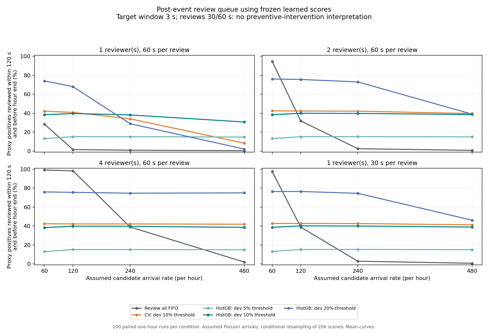

# 冻结算法分数驱动的人工复核排队模拟

这次实验回答：当同一批候选场景以假设的速率到达，有限人员逐个复核时，模型筛选如何影响工作量和及时覆盖？它不是车辆控制实验，也不测量真实接管或运营成本。模型分数来自原先训练并在开发集选定的HistGB，未用手写风险分数替代，也未根据模拟结果改变模型或阈值。

**关键时域限制：原标签只描述未来3秒内的代理事件，而这里单次复核需要30或60秒，完成期限设为120秒。最早的复核完成也已晚于标签的3秒窗口。因此全部队列指标只表示事后/离线复核资源规划，不能作为及时制动、实时干预、避免该事件或提升驾驶实时响应的证据。文中的“及时”只指人为设定的120秒复核期限。**

## 固定假设

每次运行一小时；候选按齐次Poisson过程到达，速率为每小时60、120、240、480个。分别设置1、2、4名并行复核员，每次复核固定30或60秒，空队列开始。共24种条件，各100个独立种子；每个种子在策略之间共享同一到达时间、同一场景抽样和同一边界同分随机数。
每次到达从原先206例评估样本有放回抽样，其代理事件标签、恒速分数与冻结HistGB分数一起保留。这保留了分数与标签的经验关联，但假定了候选独立同分布、无时间相关和分布漂移；反复抽样不等于获得更多真实场景。
请求进入无优先级FIFO队列，先到先服务，无取消、无抢占、无复核员差异或学习效应。主指标是全部到达代理正例中，在到达后120秒内且这一小时结束前完成事后复核的比例。小时结束仍排队/服务中的请求作为未完成保留，不把它们当作完成。
这套30/60秒服务假设与动画演示中的简化服务时间分别定义，不应混合或互相验证。
真实候选到达时间、接管需求和人工服务时长均未知；这里的数值均为人为设定的情景参数，不是对实际Uber Eats/Serve运营的估计。

## 冻结筛选策略

所有筛选阈值来自原开发集；评估集只用于固定阈值下的条件模拟。名义5%/10%/20%指开发集目标比例，在本评估样本中接受率不同。

| 策略 | 固定评估样本接受数 / 206 | 接受率 | 可覆盖代理事件 / 33（排队前） |
| --- | ---: | ---: | ---: |
| Review all FIFO | 206.00 | 100.00% | 33.00 |
| CV: dev 10% threshold | 27.00 | 13.11% | 14.00 |
| HistGB: dev 5% threshold | 5.00 | 2.43% | 5.00 |
| HistGB: dev 10% threshold | 14.00 | 6.80% | 13.00 |
| HistGB: dev 20% threshold | 46.00 | 22.33% | 25.00 |

HistGB开发集10%策略接受14/206例、覆盖13/33事件，恒速策略接受27/206例、覆盖14/33。前者工作量更低，同时筛选阶段少覆盖一个事件，不能说它在低负荷下覆盖率也更高。HistGB开发集5%策略仅覆盖5/33事件，即使精确率高也会漏掉大多数事件。

## 全部24种条件的及时覆盖均值

下表每格为全部到达代理正例的及时复核比例，不是对已筛选请求计算的精确率。2.5%/97.5%分位及所有工作量、期末积压、利用率和等待指标保存在CSV。

| 每小时候选 | 复核员 | 服务秒 | 全部FIFO | 恒速dev10 | HistGB dev5 | HistGB dev10 | HistGB dev20 |
| ---: | ---: | ---: | ---: | ---: | ---: | ---: | ---: |
| 60 | 1 | 30 | 97.5% | 42.7% | 13.3% | 38.7% | 76.5% |
| 120 | 1 | 30 | 38.9% | 42.8% | 15.3% | 40.2% | 76.5% |
| 240 | 1 | 30 | 2.9% | 42.7% | 15.4% | 40.0% | 74.5% |
| 480 | 1 | 30 | 0.8% | 41.3% | 15.1% | 38.9% | 46.2% |
| 60 | 2 | 30 | 99.6% | 42.7% | 13.3% | 38.7% | 76.5% |
| 120 | 2 | 30 | 99.2% | 42.8% | 15.3% | 40.2% | 76.6% |
| 240 | 2 | 30 | 48.6% | 42.8% | 15.4% | 40.1% | 75.5% |
| 480 | 2 | 30 | 2.6% | 42.3% | 15.1% | 38.9% | 75.6% |
| 60 | 4 | 30 | 99.7% | 42.7% | 13.3% | 38.7% | 76.5% |
| 120 | 4 | 30 | 99.4% | 42.8% | 15.3% | 40.2% | 76.6% |
| 240 | 4 | 30 | 99.2% | 42.8% | 15.4% | 40.1% | 75.5% |
| 480 | 4 | 30 | 63.7% | 42.3% | 15.1% | 38.9% | 75.7% |
| 60 | 1 | 60 | 28.3% | 42.1% | 13.1% | 38.3% | 74.0% |
| 120 | 1 | 60 | 1.6% | 40.8% | 15.2% | 39.6% | 67.9% |
| 240 | 1 | 60 | 0.9% | 34.0% | 15.2% | 38.1% | 28.8% |
| 480 | 1 | 60 | 0.4% | 8.3% | 14.8% | 30.7% | 2.1% |
| 60 | 2 | 60 | 94.6% | 42.5% | 13.1% | 38.4% | 76.0% |
| 120 | 2 | 60 | 31.8% | 42.3% | 15.2% | 39.9% | 75.5% |
| 240 | 2 | 60 | 2.5% | 42.0% | 15.2% | 39.7% | 72.9% |
| 480 | 2 | 60 | 0.7% | 39.6% | 15.0% | 38.5% | 38.9% |
| 60 | 4 | 60 | 99.2% | 42.5% | 13.1% | 38.4% | 76.0% |
| 120 | 4 | 60 | 98.2% | 42.3% | 15.2% | 39.9% | 75.6% |
| 240 | 4 | 60 | 39.0% | 42.2% | 15.2% | 39.7% | 74.7% |
| 480 | 4 | 60 | 2.0% | 42.0% | 15.0% | 38.6% | 75.0% |

## 如何解释负荷与权衡

解析负荷 rho = 候选每小时到达率 × 固定评估接受率 × 单次复核秒数 / (3600 × 复核员数)。rho描述假设长期到达/服务过程的期望负荷，单小时模拟仍包含起始空队列和结束截断效应。rho≥1提示该无限时域模型没有稳定余量；rho<1不保证120秒内完成事后复核。
低流量或人力充足时，全部复核通常覆盖最多事件；筛选本身会丢掉未选事件。高流量且人力不足时，较少而较精确的请求可能减少积压、提高有限期限内的代理事件覆盖。这是资源与覆盖的权衡，不是机器学习在所有条件下全面优胜。
较宽松的HistGB开发集20%阈值能在筛选阶段覆盖25/33事件，但也接受46/206候选；它在过载条件下可能积压。较严格阈值降低负荷同时降低覆盖上限，不能只展示低等待而忽略漏检。

## 不确定性与等待时间的边界

所有区间都是100次模拟结果的2.5%至97.5%经验分位范围，表示条件于当前206例经验分布以及Poisson/服务假设的Monte Carlo运行波动。它不是总体模型性能的置信区间，不包含样本选择、模型估计、真实分布漂移或人工时长不确定性。
p95等待仅对这一小时内已完成的请求计算，遗漏积压中最慢的请求，具有条件幸存偏差。必须同时查看期末等待数、服务中数、未完成总数和及时覆盖率。服务利用率按观测小时内实际占用服务秒数/(人员×3600)计算，包含期末未完成服务已消耗的时间。
即使请求在120秒内完成事后复核，也不能证明人工能避免三秒内的事件；该模型没有模拟复核后车辆动作、事故、真实干预或成本节省。代理事件只表示未来三秒内新进入2米轮廓间距。

## 复现与核对

运行 `python scripts/simulate_review_queue.py --predictions <predictions_2m.csv> --run <original_run_directory> --output results/queue_simulation --report docs/queue_simulation_zh.md`。该脚本读取私有冻结分数，公开产物仅含聚合指标。
每次模拟核对 请求=完成+等待+服务中，以及代理正例分解守恒。独立直接服务器分配实现复核6组事件流与边界截断案例；解析rho使用固定接受率独立复算。原始模型、开发阈值和主实验指标不变。
